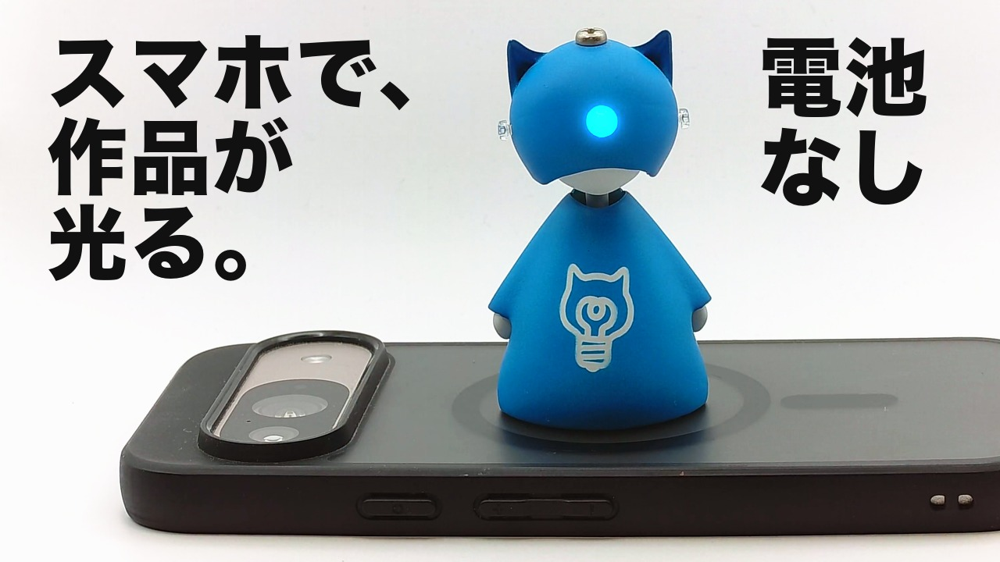
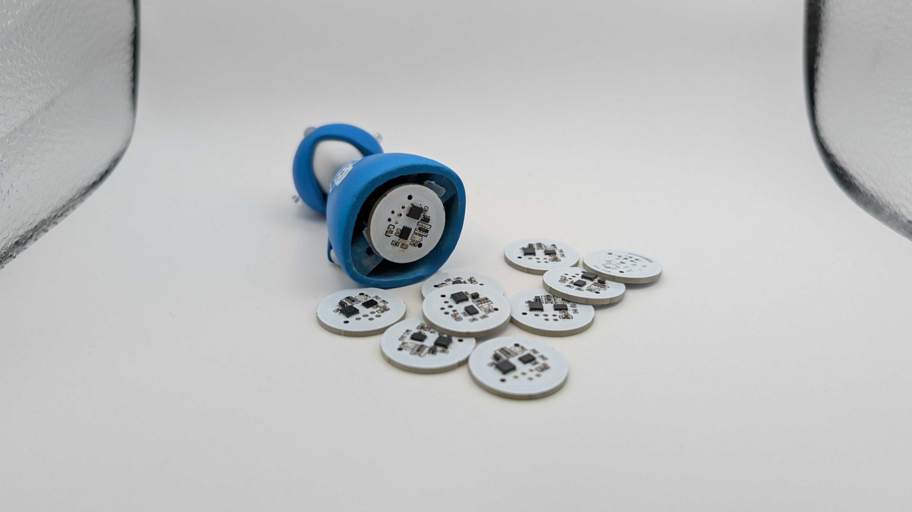
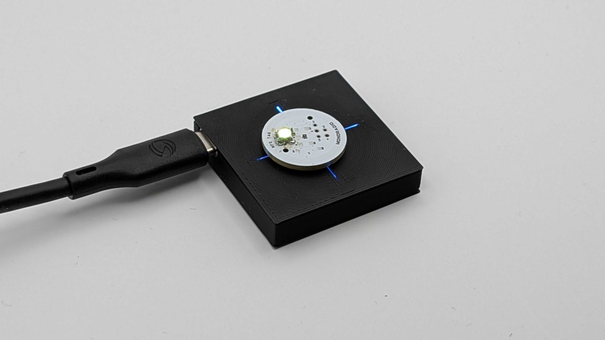
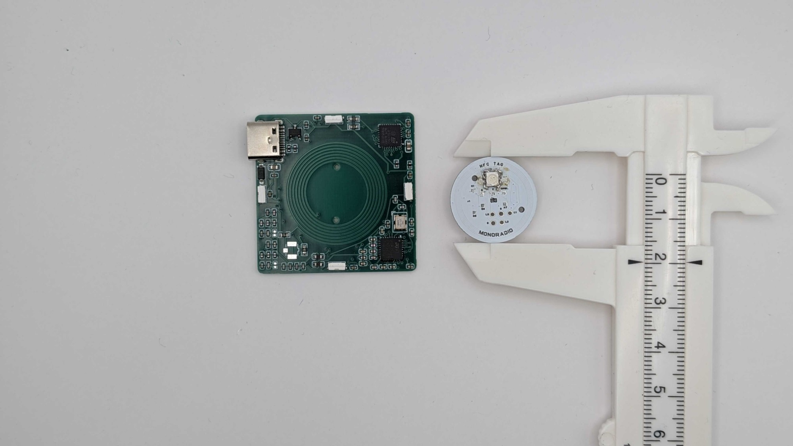
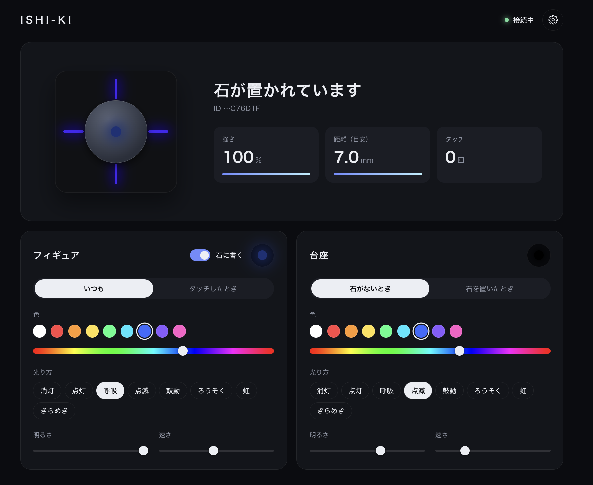

<picture>
  <source media="(prefers-color-scheme: dark)" srcset="brand/ishiki_logo_white.svg">
  
</picture>

<h1>スマホにかざすと光るNFCタグ</h1>

<h2>🚧 開発中 🚧</h2>

<b>まだ試作の段階です。回路もファームも、これから変わります。</b> 
Work in progress — the circuit and firmware will change.

  

[紹介動画（YouTube）](https://youtu.be/tV1Zj-bIpic)　·　[X](https://x.com/monoradio102/status/2121967545947471978)　·　[ブラウザの画面](https://monoradio102.github.io/ishi-ki/)　·　[回路](hardware/)　·　[ファーム](firmware/)

 

 

フィギュアやレジン作品に仕込める、電池のいらない光るタグです。
スマホや専用の台座から NFC の磁界を受けて、その電力だけでマイコンを動かし、LED を光らせます。
普通の NFC タグとしても使えるので、作品のページの URL を入れておけば、スマホをかざした人に見てもらうこともできます。

## しくみ

- NFC の磁界から電力を受け取り、マイコンを動かして点灯パターンを作っています。電池は入っていません
- タグの基板は直径 20mm。LED は最大 3 チャンネルで、基板に直付けも、線で外付けもできます
- タッチセンサーをつなぐと、触れたときに光り方が変わります
- 光り方や色の設定はタグが覚えているので、専用の台座の上でなくても、スマホにかざせば同じように光ります
- 専用の台座を USB で PC につなぐと、ブラウザから光り方を書き込めます。台座は、どのタグが置かれたかも見分けられます

## 中身

| | タグ | 専用の台座（ライター） |
|---|---|---|
| 大きさ | 直径 20mm、2 層 | 37 × 37mm、4 層 |
| NFC | ST25DV04KC（NFC タグ、電力の取り出し） | ST25R3916B（NFC リーダー） |
| マイコン | ATtiny1616 | STM32C071 |
| アンテナ | 基板のコイル（表 5 回＋裏 5 回） | 基板のコイル（外径 24mm、7 回） |
| そのほか | LED 3 チャンネル、タッチ用のパッド | USB-C、横向きの LED 4 個 |

回路図と、基板の細かいことは [hardware/](hardware/) にあります。基板のガーバーデータは入れていません。

## 使い方

1. タグと台座に、それぞれのファームを書き込みます（[firmware/](firmware/)）
2. 台座を USB で PC につなぎ、[ブラウザの画面](https://monoradio102.github.io/ishi-ki/) を Chrome か Edge で開いて「台につなぐ」を押します
3. 台座にタグを置くと、色・光り方・明るさ・速さと、タッチしたときの光り方を書き込めます

## 追加予定の要素

- Rev.2 の基板（Rev.1 で分かった問題を直す。[hardware/](hardware/) の「Rev.1 の既知の問題」）
- 台座から、光り方をリアルタイムに変える（音楽に合わせて光る、など）
- タッチ以外のセンサー（温度、明るさ）にファームで対応する
- 台座を並べて、どのタグをどこに置いたかが分かる盤にする

## ライセンス

[MIT](LICENSE)（回路・ファーム・ブラウザの画面のすべて）

---

MONORADIO　[X](https://x.com/monoradio102)　·　[HP](https://monoradio.jp/)
