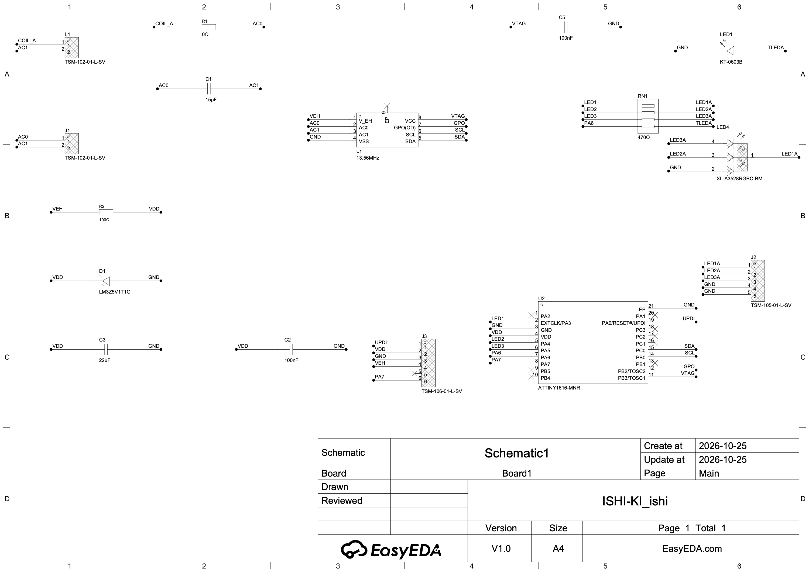
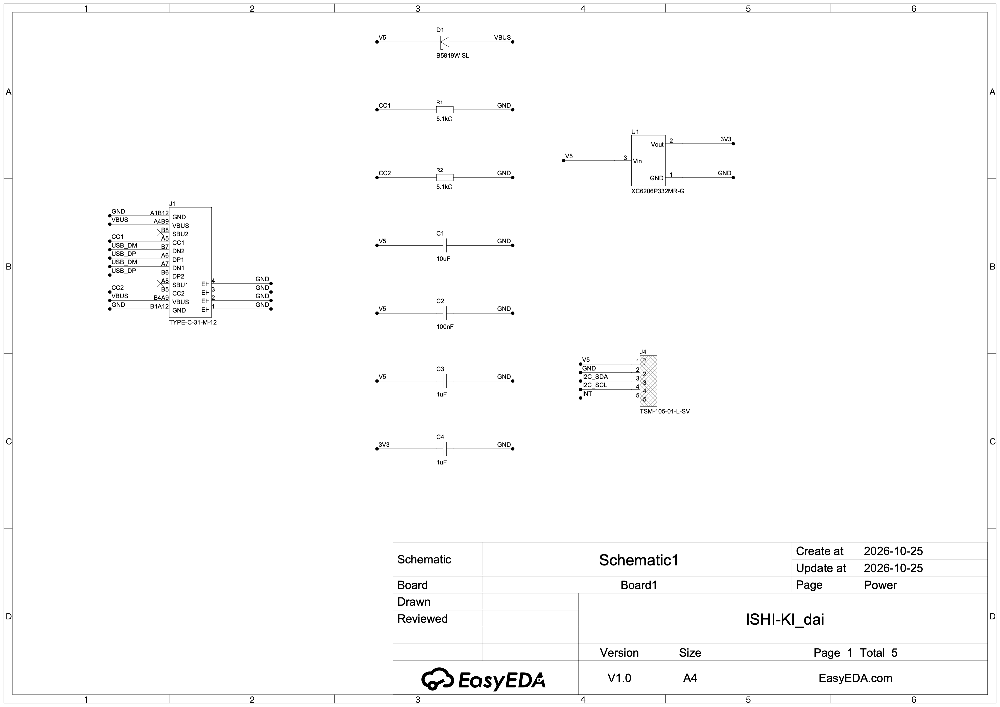
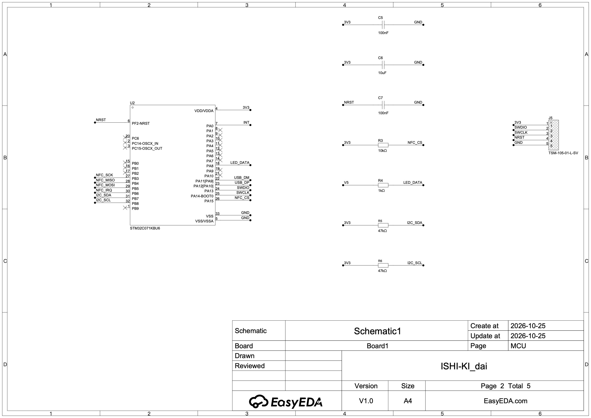
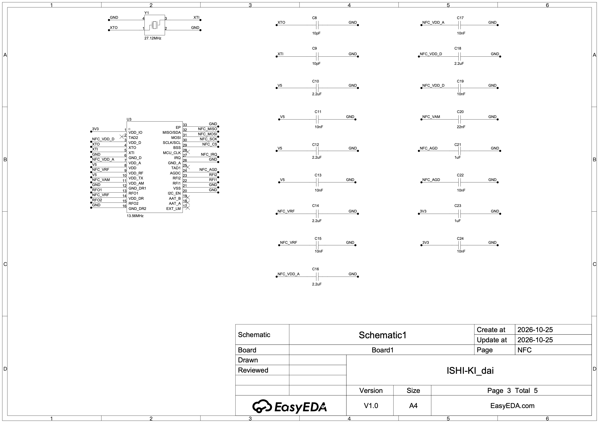
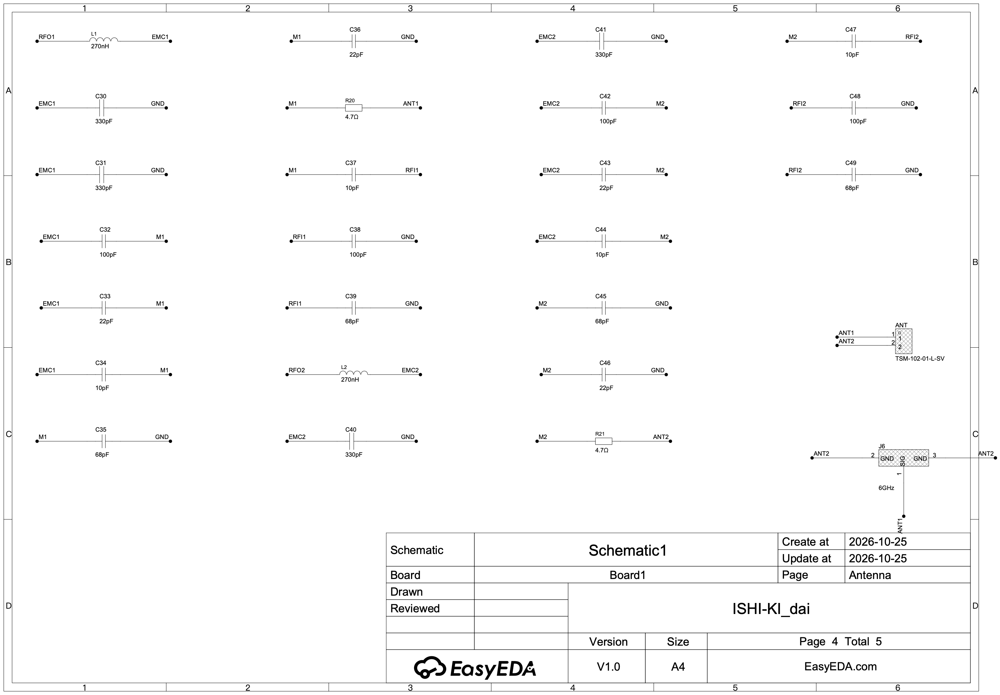
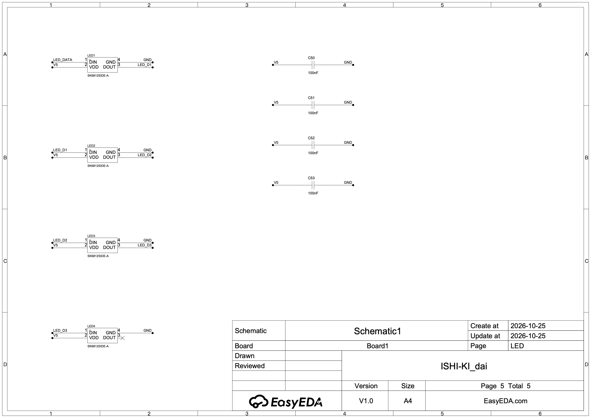
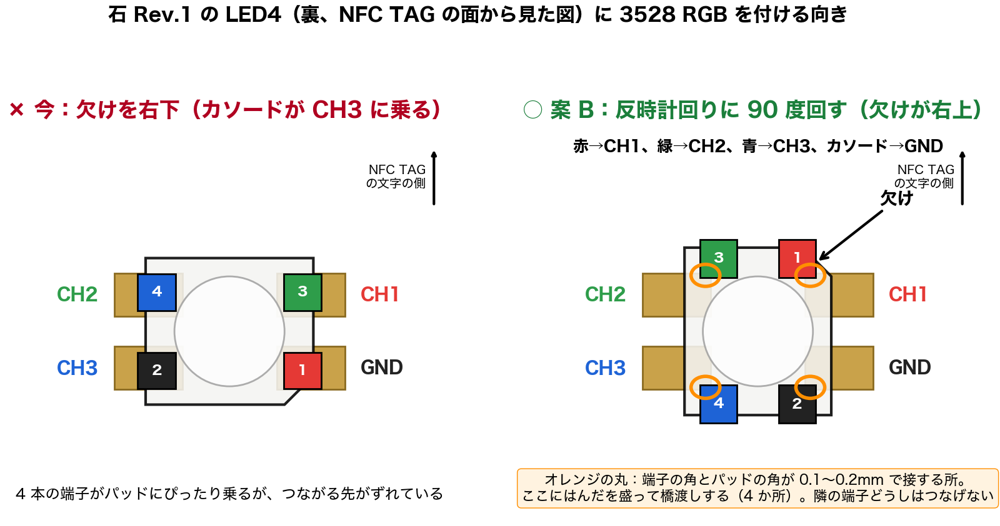

# 回路

> [!IMPORTANT]
> 開発中です。ここにあるのは試作の Rev.1 の回路図です。基板のガーバーデータは公開していません。

- タグ: [schematic_tag.pdf](schematic_tag.pdf)
- 専用の台座（ライター）: [schematic_writer.pdf](schematic_writer.pdf)（電源・マイコン・NFC・アンテナ・LED の 5 ページ）



## タグ（直径 20mm、2 層）

```txt
 基板のコイル ── ST25DV04KC ── I2C・GPO・VTAG ── ATtiny1616 ── PA3 / PA4 / PA5 ── LED 3 チャンネル
                    │ V_EH（取り出した電力）                    └ PA6 ── 確認用の青 LED
                    └── 100Ω ── VDD（5.1V のツェナーで上限、22µF）
```

- 電池はありません。NFC の磁界から ST25DV04KC が取り出した電力（V_EH）で、マイコンと LED が動きます
- ST25DV04KC の電源（VTAG）はマイコンのピンからとり、タグを読み書きする間だけ入れます
- I2C はソフトウェアで、プルアップはマイコンの内蔵のものを使います

### ピン（ATtiny1616）

| ポート | 使い道 |
|---|---|
| PA3 / PA4 / PA5 | LED の CH1 / CH2 / CH3（PWM） |
| PA6 | 確認用の青 LED |
| PA7 | タッチ（裏の A7 パッド。PTC の自己容量） |
| PB3 | VTAG（ST25DV の電源） |
| PB2 | GPO 入力 |
| PB0 / PC0 | SCL / SDA |
| PA0 | UPDI（書き込み） |

### LED のつなぎ方

- **穴（J2）**: 2.0mm 間隔の穴が 5 個（L1・L2・L3 がアノード、G が共通の GND）。細い線や、チップ LED、砲弾型 LED の足をつなげます
- **RGB LED のパッド（LED4、裏）**: 3528 のカソード共通 RGB LED を付けるパッド（Rev.1 には問題があります。下を見てください）
- 抵抗は 470Ω のアレイが基板に載っています

### 裏のパッド

| 名前 | 使い道 |
|---|---|
| UPDI・V・G | 書き込み（2.54mm 間隔） |
| A7 | タッチの電極をつなぐ |
| EH | 取り出した電力の測定用 |
| C0・C1 | 外付けのコイル用（0Ω の R1 を外して使う） |

## 専用の台座（37 × 37mm、4 層）

| 部分 | 部品 |
|---|---|
| NFC | ST25R3916B（SPI） |
| マイコン | STM32C071KBU6（水晶なしの USB、USB DFU で書き換え） |
| USB | USB-C（5V） |
| 3.3V | XC6206P332 |
| 水晶 | 27.12MHz |
| LED | SK6812SIDE-A × 4（4 辺のまん中、横向き） |
| アンテナ | 表面の中央、外径 24mm・7 回巻き |

台座の回路図（1 ページ目から順に、電源・マイコン・NFC・アンテナ・LED）

 
 


## Rev.1 の既知の問題

- **タグの LED4（RGB LED）のパッドの番号が、XL-A3528RGBC-BM のデータシートと 90 度ずれています。** そのまま付けると、カソードが GND に来ません。LED を 90 度回して（下の図）、角どうしをはんだでつなぐと使えます。線で外付けする場合は、この問題はありません

  

- **タグの共振用のコンデンサ C1 は 22pF が合います**（Rev.1 は 15pF）。実測で、15pF では 14.5MHz、22pF で 13.5MHz でした
- **台座のアンテナの整合回路は、まだ合わせ込んでいません**

## ライセンス

[MIT](../LICENSE)
